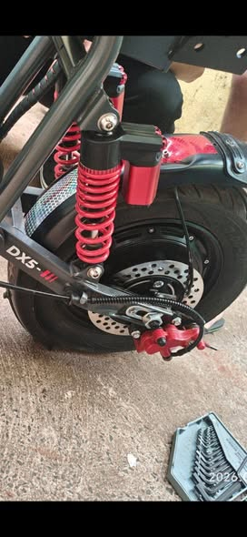
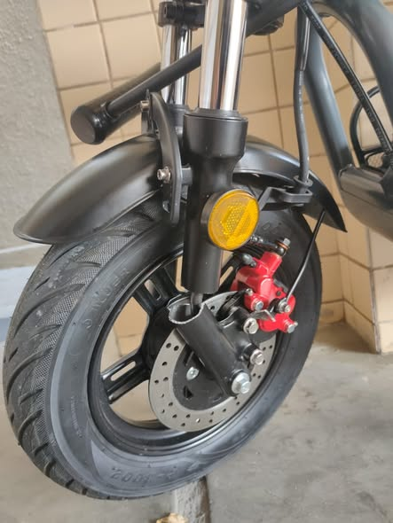

# iScooter Problems and Solutions Report

This report summarizes an automated collection of messages from the [iScooter DX5/Pro Facebook group](https://www.facebook.com/groups/2207593166715553/). The archived posts have observed publication dates from **12 February 2026 to 21 November 2026** (Facebook-displayed dates; times and time zones may be uncertain). This range does not guarantee full group coverage.
## Accident highlights

| Reported event and associated issue | Frequency in reviewed posts | Original Facebook posts |
| :--- | ---: | :--- |
| Two posts report the same rear-fender failure and associated traffic accident: one says the fender broke away and caught the rear tyre, causing the rider to land on the ground; the related post identifies the fender-support weld as the first break and says the accident happened in traffic. The posts appear to describe the same event, not two separate accidents. These are member reports, not independently verified findings. Photo attached to the related source post (illustrative; not independent verification):  | 2/581 (0.3%) | [First account](https://www.facebook.com/groups/2207593166715553/posts/2445671876241013/); [related account](https://www.facebook.com/groups/2207593166715553/posts/2445956419545892/) |
| Potential severe accident risk (no accident reported): a rider says the front suspension broke during a sudden stop; the author denies a fall, and the cause is disputed. The archived photo shows a lower fork leg separated above the axle. This image illustrates the potential hazard; it does not document an accident.    | 1/581 (0.2%) of reviewed posts report this failure; no accident count is established. | [Open source post](https://www.facebook.com/groups/2207593166715553/posts/2413093546165513/) |

## Problems, questions and suggestions

| Category | Problem summary | Frequency in reviewed posts | Possible solution or suggestion | Original Facebook post |
|---|---|---:|---|---|
| Structure and safety | The rear fender support reportedly broke, and the detached fender caught the tyre during the accident described in two related posts. The posts appear to refer to the same event. | 2/581 (0.3%) | A member suggests removing the rear fender to reduce risk; this is advice, not a verified repair. | [First account](https://www.facebook.com/groups/2207593166715553/posts/2445671876241013/); [related account](https://www.facebook.com/groups/2207593166715553/posts/2445956419545892/) |
| Structure and safety | An author says a fall damaged the front forks and foot pegs; the cause of the fall is not stated. A commenter asks whether the forks were twisted in the clamps and suggests loosening and straightening them; the author says they were damaged. | Not determinable | The suggested adjustment has no recorded outcome. A separate commenter says replacement parts were difficult to obtain. | [Open post](https://www.facebook.com/groups/2207593166715553/posts/2439262433548624/) |
| Structure and safety | Members describe thin or bent foot pegs; a separate commenter says their custom aluminum footboards bent. These are distinct accounts, and the custom part is not treated as a stock-component failure. | Not determinable | Stronger replacement pegs and added grip are discussed; no verified replacement outcome is recorded. | [Foot peg reports](https://www.facebook.com/groups/2207593166715553/posts/2412450226229845/); [custom footboards](https://www.facebook.com/groups/2207593166715553/posts/2402785233863011/) |
| Suspension | A commenter asks for advice after their rear shock broke once the scooter was running. The original post appears to be a range discussion. | Not determinable | No solution is visible in the collected material. | [Open post](https://www.facebook.com/groups/2207593166715553/posts/2482639765877557/) |
| Suspension and steering | A rider reports the front suspension breaking during a sudden stop to avoid an oncoming motorcycle at under 20 km/h. The supplied photo visibly shows a lower front fork leg separated above the axle. If such a separation occurred while riding, it could cause a severe crash; this is a potential-risk assessment, not a reported accident. The author denies a fall; a commenter alleges an impact, so the cause remains disputed and unverified. | 1/581 (0.2%) | The author asks about compatible replacement parts and considers replacing the full front suspension. A commenter suggests contacting the seller about exchange or refund; the author later says the supplier had not resolved it. | [Open post](https://www.facebook.com/groups/2207593166715553/posts/2413093546165513/) |
| Suspension and steering | Members report front fork/headset play or a small fork/steering-bearing problem; a separate commenter reports a clunk from the original fork on small bumps. | Not determinable | One commenter suggests loosening the upper clamp, tightening the head bolt, then retightening the clamp. Another author planned a repair; no outcome is recorded. | [Fork/headset play](https://www.facebook.com/groups/2207593166715553/posts/2513418332799700/); [fork clunk](https://www.facebook.com/groups/2207593166715553/posts/2449160155892185/); [bearing concern](https://www.facebook.com/groups/2207593166715553/posts/2501024900705710/) |
| Wheels | Members report bent motor-wheel rims after potholes; another asks about a bent rear motor wheel that was difficult to replace. One rider says they did not fall; another reports a pothole hit at speed while carrying a passenger, with no fall reported. | Not determinable | One seller reportedly sent a replacement wheel and the original tyre was reused. Other members suggest a replacement hub motor or careful rim reshaping; these remedies are unverified. | [Pothole case](https://www.facebook.com/groups/2207593166715553/posts/2330420747766127/); [rear wheel replacement question](https://www.facebook.com/groups/2207593166715553/posts/2460577464750454/); [passenger case](https://www.facebook.com/groups/2207593166715553/posts/2500325610775639/) |
| Wheels | A rider reports a bent rim after hitting a pothole at speed while carrying a passenger. No fall is reported. | Not determinable | Commenters suggest using a mallet with protection or replacing the motor wheel. The author had not yet reported an outcome. | [Open post](https://www.facebook.com/groups/2207593166715553/posts/2500325610775639/) |
| Wheels and tyres | A rear tubeless tyre went flat; the author asks how to reinflate it or find a replacement. | Not determinable | A commenter describes tyre sealant and a compressor, based on their own similar repair; the advice is not independently verified. | [Open post](https://www.facebook.com/groups/2207593166715553/posts/2539686083506258/) |
| Wheels and tyres | A rider reports rear wheel bounce during turns and slowing while using the original rear shocks; they say the bounce stopped after fitting different shocks. | Not determinable | The author reports that replacing the shocks resolved the bounce for their modified setup; this is a single member-reported outcome. | [Open post](https://www.facebook.com/groups/2207593166715553/posts/2510505263091007/) |
| Brakes and wheels | Multiple owners report difficulty fitting or centring the front wheel, spacers and brake disc. Another reports loud front-wheel rubbing after assembly, and one account says a fender-bracket adjustment solved an installation problem. A comparison-thread commenter also reports front-wheel, fork and disc fit/finish issues; its video is unavailable. | Not determinable | Replies suggest loosening the assembly or fender bracket and checking spacer orientation. Outcomes differ; no single verified fix is established. | [Spacer and wheel assembly](https://www.facebook.com/groups/2207593166715553/posts/2403028950505306/); [front wheel and brake setup](https://www.facebook.com/groups/2207593166715553/posts/2460183551456512/); [bracket adjustment](https://www.facebook.com/groups/2207593166715553/posts/2339622590179276/); [rubbing case](https://www.facebook.com/groups/2207593166715553/posts/2444283353046532/); [comparison thread](https://www.facebook.com/groups/2207593166715553/posts/2523304718477728/) |
| Brakes | A new scooter reportedly arrived with an empty rear brake reservoir after fluid leaked inside the shipping box. | Not determinable | Members give conflicting fluid suggestions. The author says support supplied the specification, but the specification is not in the capture. | [Open post](https://www.facebook.com/groups/2207593166715553/posts/2534057540735779/) |
| Brakes | A rider reports one brake-fluid reservoir was empty and asks whether its marking means DOT 3 or DOT 4. | Not determinable | A commenter replies “Yes”; the exchange does not document a repair or confirm which system the marking describes. | [Open post](https://www.facebook.com/groups/2207593166715553/posts/2402978090510392/) |
| Brakes | A rider says the front brake feels very weak and asks how to restore it. | Not determinable | **Not identified in the collected material.** No comments or remedy were captured. | [Open post](https://www.facebook.com/groups/2207593166715553/posts/2536463203828546/) |
| Brakes and wheels | Riders report a grinding noise, rear-tyre noise each rotation, brake noise after extended riding, a mower-like sound with suspected rotor warping, and a stiff rear wheel with pads touching the disc. The causes are not established. | Not determinable | Suggestions include checking axle pressure, rotor runout, impact damage and pads, or cleaning the disc. One author says rubbing alcohol seemed to help; other outcomes are unreported. | [Grinding noise](https://www.facebook.com/groups/2207593166715553/posts/2378573149617553/); [noise after 750 miles](https://www.facebook.com/groups/2207593166715553/posts/2523316818476518/); [mower-like noise](https://www.facebook.com/groups/2207593166715553/posts/2507460406728826/); [wheel and pad contact](https://www.facebook.com/groups/2207593166715553/posts/2451712332303634/) |
| Brakes and controls | A commenter says the motor kept driving while they applied the brake; the same thread mentions intermittent throttle sticking. | Not determinable | Another member calls this a serious safety concern and advises stopping use, contacting the seller or replacing the controller. No confirmed repair is recorded. | [Open post](https://www.facebook.com/groups/2207593166715553/posts/2507460406728826/) |
| Power and startup | A rider says the scooter shut down after a small bump and would not power back on; the charger light turned red. | Not determinable | Commenters suggest checking a breaker and battery connections. No outcome is recorded. | [Open post](https://www.facebook.com/groups/2207593166715553/posts/2513584052783128/) |
| Power and startup | A Spanish post says the scooter switches off when the rider starts using it. The saved text ends mid-word. | Not determinable | No comments or solution were captured; the text is truncated. | [Open post](https://www.facebook.com/groups/2207593166715553/posts/2532920044182862/) |
| Power and startup | A scooter powers on but will not move and displays a park/ECU message. | Not determinable | Members suggest brake, selector, sensor and reset steps. The author says several attempts did not work; a later reset suggestion has no recorded result. | [Open post](https://www.facebook.com/groups/2207593166715553/posts/2478083559666511/) |
| Power and startup | A newly assembled scooter reportedly would not start even after charging overnight. | Not determinable | Commenters suggest checking battery connections, the fuse switch and charging. The available capture does not establish a successful fix. | [Open post](https://www.facebook.com/groups/2207593166715553/posts/2376428803165321/) |
| Electrical and display | A display reportedly stopped working while the NFC indicator flashed, the alarm activated and tags stopped responding after shutdown. | Not determinable | The author says the display was tested on another vehicle; replacement/support discussion is visible, but no completed repair is recorded. | [Open post](https://www.facebook.com/groups/2207593166715553/posts/2354924771982391/) |
| Electrical and display | An author says their display broke and they could not find a replacement. | Not determinable | A commenter suggests replacing the controller; this is not a verified diagnosis or fix. | [Open post](https://www.facebook.com/groups/2207593166715553/posts/2537312247076975/) |
| Electrical and wiring | Two commenters report wiring-harness problems on new scooters; one says three dashboards and a controller did not solve their issue and a requested harness was not supplied. | Not determinable | Warranty contact is reported, with no resolution captured. The source uses the “Most relevant” filter and may omit comments. | [Open post](https://www.facebook.com/groups/2207593166715553/posts/2537508483724018/) |
| Lighting | An author says the stock brake light is dim and describes swapping light functions and adding front indicators. | Not determinable | The author describes their modification; effectiveness and compatibility are unverified. | [Open post](https://www.facebook.com/groups/2207593166715553/posts/2310885423052993/) |
| Lighting and wiring | A member says light controls burned when powered at 60 V although the headlight was rated for 72 V. | Not determinable | A commenter suggests a step-down converter; the author says the setup worked for a while, but no repair outcome is recorded. | [Open post](https://www.facebook.com/groups/2207593166715553/posts/2520408348767365/) |
| Instrumentation | Members report odometer or speed readings that differ from GPS or appear doubled; another says the replacement display shows miles when they want kilometres. | Not determinable | One author says the seller was working on a fix/reset and offered a partial refund; another uses a phone app as a workaround. No completed display correction is verified. | [GPS comparison](https://www.facebook.com/groups/2207593166715553/posts/2517763949031805/); [doubled reading](https://www.facebook.com/groups/2207593166715553/posts/2376428803165321/); [displayed distance](https://www.facebook.com/groups/2207593166715553/posts/2377438806397654/); [unit display](https://www.facebook.com/groups/2207593166715553/posts/2376515903156611/); [unit workaround discussion](https://www.facebook.com/groups/2207593166715553/posts/2393559381452263/) |
| Battery indication and range | A rider reports battery bars fluctuating and showing one white bar above red after a trip under 10 miles. | Not determinable | No diagnosis or remedy is captured; the record also includes a seat-comfort question. | [Open post](https://www.facebook.com/groups/2207593166715553/posts/2540795523395314/) |
| Parts and service | A rider reports a leaking fork oil seal and asks where to obtain a replacement. | Not determinable | A commenter suggests asking a cycle shop; no repair outcome is recorded. | [Open post](https://www.facebook.com/groups/2207593166715553/posts/2502816640526536/) |
| Structure and safety | A commenter reports that rear-wheel/frame welds broke in under a month on paved roads, leaving them without the rear wheel. No fall is stated. | 1/581 (0.2%) | No verified repair is visible in the collected material; the member says they kept the scooter for parts. | [Open post](https://www.facebook.com/groups/2207593166715553/posts/2445956419545892/); [related update](https://www.facebook.com/groups/2207593166715553/posts/2446102099531324/) |
| Structure and controls | An author reports the handlebar still moves after tightening; one screw broke and another screw head stripped. | 1/581 (0.2%) | A commenter planned to try a shim; no outcome was captured. | [Open post](https://www.facebook.com/groups/2207593166715553/posts/2339366870204848/) |
| Structure and controls | A member reports that a parked scooter fell after the kickstand lifted following a brake-lever change; the handlebar broke. The cause of the stand lifting is not established. | Not determinable | Another member describes a separate collision-related bent handlebar; that damage is not attributed to a scooter failure. No repair is captured. | [Open post](https://www.facebook.com/groups/2207593166715553/posts/2487165998758267/) |
| Suspension and steering | A member reports a broken front fork and difficulty finding a replacement. Other posts ask for fork parts but appear to concern the same member; they are not counted as independent failures here. | 1/581 (0.2%) | Replacement availability was a concern; no confirmed repair is recorded. | [Reported fork break](https://www.facebook.com/groups/2207593166715553/posts/2478531096288424/); [parts discussion](https://www.facebook.com/groups/2207593166715553/posts/2479446092863591/); [repost](https://www.facebook.com/groups/2207593166715553/posts/2480441916097342/) |
| Suspension and steering | A commenter reports the front shock inside its coil was broken; the author had ordered a replacement shock, but fit and repair outcome are not recorded. | 1/581 (0.2%) | Replacement was ordered; compatibility and installation outcome are unverified. | [Open post](https://www.facebook.com/groups/2207593166715553/posts/2480777729397094/) |
| Rear wheel and structure | An owner reports that tightening the rear axle without a sufficient spacer put stress on the fork and bent it inward, leaving the rear wheel off-centre and the brake pads rubbing. A commenter speculates the hub axle was too short; the author disputes this and attributes it to a missing spacer. | 1/581 (0.2%) | The author added washers and says the fork no longer sits under forced bending. The caliper had been removed, and the author planned to recheck alignment after reinstalling it; no final result is recorded. | [Open post](https://www.facebook.com/groups/2207593166715553/posts/2469960143812186/) |
| Wheels and tyres | A member reports the rear tyre blew and asks where to find a replacement. | 1/581 (0.2%) | Members suggest replacement sizes, but fit is unverified. | [Open post](https://www.facebook.com/groups/2207593166715553/posts/2431358661005668/) |
| Wheels and brakes | A rider reports loud front-wheel rubbing after assembly; a separate commenter reports caliper rubbing in the duplicate discussion. A French post reports caliper contact and wheel movement after tightening. All 11 displayed comments were reviewed with All comments selected; attached videos were not viewed. | Not determinable | Caliper alignment and pad checks are suggested; no consistent verified fix is documented. One author's two posts describe the same case. | [First rubbing post](https://www.facebook.com/groups/2207593166715553/posts/2444283353046532/); [duplicate discussion](https://www.facebook.com/groups/2207593166715553/posts/2444290169712517/); [French report](https://www.facebook.com/groups/2207593166715553/posts/2537744123700454/) |
| Brakes | A rider asks about repeated clicking at the front brake pads. | 1/581 (0.2%) | Comments suggest checking or cleaning the pads; no confirmed remedy is reported. | [Open post](https://www.facebook.com/groups/2207593166715553/posts/2487875402020660/) |
| Power and controls | Members report power cutting out over bumps or while riding, a separate vehicle stopping after a short distance, and an unanswered sudden-shutdown report in comments. In one thread, tightening the brake levers reportedly stopped the cut-outs, with brake sensors suspected; other causes remain unresolved. | Not determinable | Suggestions include checking brake sensors, the battery switch and connectors. Outcomes differ and are not independently verified. | [Cut-out over bumps](https://www.facebook.com/groups/2207593166715553/posts/2412630962878438/); [repeated cut-outs](https://www.facebook.com/groups/2207593166715553/posts/2479580202850180/); [stopped after 4 km](https://www.facebook.com/groups/2207593166715553/posts/2487317978743069/); [shutdown report in comments](https://www.facebook.com/groups/2207593166715553/posts/2532097234265143/) |
| Power and controls | A member reports a broken throttle and seeks a replacement; a separate French post reports that the throttle did not respond, with a commenter describing a cut wire on another vehicle. | Not determinable | Replacement was sought; wire inspection is a member suggestion, not a verified repair for the original post. | [Broken throttle](https://www.facebook.com/groups/2207593166715553/posts/2422822281859306/); [throttle not responding](https://www.facebook.com/groups/2207593166715553/posts/2509852409822959/) |
| Electrical and wiring | Members report headlight, horn, indicator, harness and control problems; reports include front lights and horn not working while the rear light works, no drive despite a powered display, reversed indicators, and controls failing to select gears or operate. One author says a connector change restored lights and horn but left the battery indication unresolved; another reports a repair. | Not determinable | Suggestions include checking or reseating connectors; outcomes differ and are not verified across vehicles. | [Front light and horn](https://www.facebook.com/groups/2207593166715553/posts/2366194930855375/); [switch and harness](https://www.facebook.com/groups/2207593166715553/posts/2416459565828911/); [headlight and horn](https://www.facebook.com/groups/2207593166715553/posts/2424686711672863/); [connector change](https://www.facebook.com/groups/2207593166715553/posts/2443984219743112/); [no drive and reversed indicators](https://www.facebook.com/groups/2207593166715553/posts/2450498422425025/); [indicator discussion](https://www.facebook.com/groups/2207593166715553/posts/2450028955805305/); [duplicate post one](https://www.facebook.com/groups/2207593166715553/posts/2476969599777907/); [duplicate post two](https://www.facebook.com/groups/2207593166715553/posts/2476971436444390/); [controls not working](https://www.facebook.com/groups/2207593166715553/posts/2510341059774094/) |
| Charging | Members report a charger that is dead, becomes extremely hot, shows green while not charging, or stops with a blinking green light and low battery indication. These are separate symptoms and no common cause is established. | Not determinable | Members suggest checking connector position or temperature; advice conflicts and is unverified. | [Charging stopped](https://www.facebook.com/groups/2207593166715553/posts/2419019642239570/); [dead charger](https://www.facebook.com/groups/2207593166715553/posts/2425579794916888/); [hot charger](https://www.facebook.com/groups/2207593166715553/posts/2438470203627847/); [green but not charging](https://www.facebook.com/groups/2207593166715553/posts/2438599793614888/) |
| Power and wiring | A rider reports a breaker/switch that trips while riding or will not stay on; another says the switch no longer stays engaged when turned on. | Not determinable | Members suggest replacing or repositioning the switch; no durable repair outcome is verified. | [Breaker problem](https://www.facebook.com/groups/2207593166715553/posts/2466780674130133/); [switch trips](https://www.facebook.com/groups/2207593166715553/posts/2484133972394803/); [switch replacement discussion](https://www.facebook.com/groups/2207593166715553/posts/2502120187262848/) |
| Motor | A member reports that the motor stopped and began making a loud noise after a high-speed ride. | 1/581 (0.2%) | The author says they would replace the motor; cause and replacement outcome are not verified. | [Open post](https://www.facebook.com/groups/2207593166715553/posts/2404136810394520/) |
| Battery and safety | A member reports that trying to combine two identical batteries burned everything out; the account is unverified. The original author is asking how to add a second battery, and no outcome for that author is recorded. | 1/581 (0.2%) | Members discuss matching voltage, chemistry and age, charging separately or in parallel, and report one prior attempt that burned out; these are unverified member claims, not a confirmed safe method. | [Open post](https://www.facebook.com/groups/2207593166715553/posts/2544246466383553/) |
| Suspension | A rider reports rear suspension clunking and weak response; other members report rear bouncing or clunks on rough paths. These accounts include different setups and do not establish a shared cause. | Not determinable | Shock replacement is suggested; one rider reports bounce stopped after changing shocks, while other outcomes are unverified and dimensions differ. | [Weak and clunking rear suspension](https://www.facebook.com/groups/2207593166715553/posts/2493126768162190/); [clunk on rough paths](https://www.facebook.com/groups/2207593166715553/posts/2495552337919633/); [rear bounce report](https://www.facebook.com/groups/2207593166715553/posts/2369095247232010/) |
| Handling and safety | A rider reports high-speed wobble on a modified setup. Another reports instability with wider-than-stock tyres at speed; cause and compatibility are not established. | Not determinable | Members discuss geometry and tyre changes, but no verified remedy is recorded. | [High-speed wobble](https://www.facebook.com/groups/2207593166715553/posts/2430184027789798/); [wide tyres and instability](https://www.facebook.com/groups/2207593166715553/posts/2392363491571852/) |
| Tyres and wheels | A rider says the original rear tyre was bald after about 2,000 km and had fitted different tyres. | 1/581 (0.2%) | Replacement tyres were fitted; durability of the replacement and cause of wear are not established. | [Open post](https://www.facebook.com/groups/2207593166715553/posts/2475103366631197/) |
| Parts and assembly | A member reports receiving a damaged box, chipped paint and stripped or bent screws; they suspect the unit may have been repacked, but this is unverified. | 1/581 (0.2%) | The seller invited the author to contact support; no resolution is captured. | [Open post](https://www.facebook.com/groups/2207593166715553/posts/2435886203886247/) |
| Brakes and assembly | An owner reports that brake-lever clamp screws were too tight to fit the handlebars. | 1/581 (0.2%) | The author says a local shop resolved the fitment problem; method not recorded. | [Open post](https://www.facebook.com/groups/2207593166715553/posts/2509400266534840/) |
| Seats and comfort | Members report discomfort after riding or say the seat is not sufficiently strong. Other commenters report improved comfort after adding cushions; these are separate personal accounts. | Not determinable | Cushions or a replacement motorcycle seat are suggested; fit, durability and results vary by rider. | [Seat discomfort](https://www.facebook.com/groups/2207593166715553/posts/2380189269455941/); [seat strength and comfort](https://www.facebook.com/groups/2207593166715553/posts/2493126768162190/); [cushion discussion](https://www.facebook.com/groups/2207593166715553/posts/2449966959144838/); [another cushion report](https://www.facebook.com/groups/2207593166715553/posts/2526259061515627/) |
| Performance | A rider reports being unable to climb their usual hills with two people aboard. Other members describe reduced hill performance on modified setups, with no confirmed defect or common cause. | Not determinable | Suggestions include battery/controller modifications; results and compatibility are unverified. | [Hill-climbing report](https://www.facebook.com/groups/2207593166715553/posts/2356401631834705/); [modified setup discussion](https://www.facebook.com/groups/2207593166715553/posts/2528331024641764/) |
| Power and controls | A member reports a red warning and throttle hesitation; other commenters describe cut-outs or broken throttle pins on their own vehicles. The reports are separate and do not establish a common cause. | Not determinable | The author suspects a brake switch after adjusting it, but no long-term outcome is recorded. | [Open post](https://www.facebook.com/groups/2207593166715553/posts/2453386265469574/) |
| Battery and charging safety | A new owner reports a low battery indication after a long charge despite a green charger light, together with a non-working headlight and horn. | 1/581 (0.2%) | The author says a connector change restored the lights and horn, but the battery indication remained unresolved. | [Open post](https://www.facebook.com/groups/2207593166715553/posts/2443984219743112/) |
| Questions without a confirmed fault | Members ask about tyre pressure, part sourcing, compatibility, charging, battery upgrades, legal use, range or accessories without an explicit failure report. | Not determinable | Suggestions and personal claims are not verified solutions. | [Tyre pressure](https://www.facebook.com/groups/2207593166715553/posts/2520124782129055/); [battery/controller question](https://www.facebook.com/groups/2207593166715553/posts/2521319958676204/) |
## Scope and method

- **Directories analyzed:** 583 `post.md` directories: 581 original-post records and 2 Facebook system events. System events are excluded from the report.
- **Review scope:** 581 fully reviewed original-post IDs. All accessible text and displayed comments for the two reopened records were reviewed; media gaps remain: two videos on 2537744123700454 and one image on 2544246466383553 were not examined. These gaps are disclosed and no media content is inferred.
- **Frequency formula:** `n/N × 100`, rounded to one decimal place, where `n` is the number of distinct, fully reviewed original-post IDs containing at least one independent, explicit report of that specific problem or event and `N = 581` eligible original-post IDs. Each ID counts at most once per row; system events are excluded. Rows are marked **Not determinable** when a complete numerator cannot be established from the reviewed material; questions alone do not count as reports.
- **Partial and inaccessible material:** 572 original-post records are marked partial and 9 complete for accessible content. Some records retain partial collection status. The two reopened records are included in review scope based on their accessible text and comment threads; attached media remains unexamined. Administrative complete status does not prove all Facebook comments or attachments were captured.
- **Review date:** 23 November 2026.
- **Interpretation:** Percentages, when shown, are proportions of reviewed post IDs with explicit reports, not incidents, owners, vehicles, defects or rates across the group. Related reports may describe the same event. Incomplete captures and self-selection may affect the material.
- **Accident screening:** The two fender-weld posts are linked reports of one event and both IDs meet the table rule. A wheel/swingarm request after a vehicle was run over by a semi, a crash attributed to riding conditions, an unexplained “I went down” comment, hypothetical legal discussion, and the front-suspension break during a sudden stop were excluded from Accident highlights because the impact allegation in a comment is disputed by the author and no scooter-failure-related accident is established. They are not treated as scooter-failure-related accidents.
- **Limitations:** Original posts and comments may be translated, truncated, filtered, or captured with interface text. Reply hierarchy and counts are often uncertain. Several images and videos were not available or examined; their contents are not inferred. Local review does not mean all Facebook pages were reopened. Suggestions are attributed to members and are not treated as verified repairs unless an author reports an outcome.